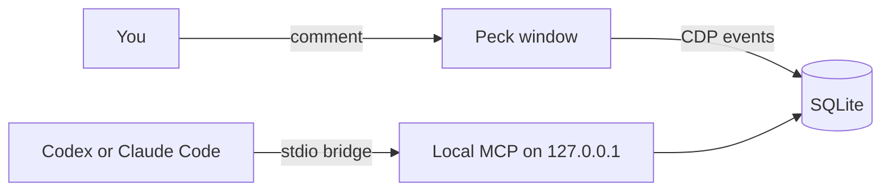

<div align="center">

<h1>Peck</h1>

<p><strong>Point at a page element and give your coding agent the full context.</strong></p>

[](https://github.com/zyx1121/peck/actions)
[](https://github.com/zyx1121/peck/releases)
[](https://github.com/zyx1121/peck/releases/latest)
[](LICENSE)

**English** | [繁體中文](README.zh-TW.md) | [简体中文](README.zh-CN.md)

</div>

> Use Peck to watch my comments. Read each item's screenshot and debug context, fix the current project's source, verify the result, and reply in the comment.

Peck is a Chromium desktop browser for you and your coding agent. You point at an element and write a comment. Your existing Codex or Claude Code conversation then gets the screenshot, selector, console errors and network records.

## Features

- **Comments on elements**: select an element with Cmd+Shift+C, write a comment, and read the agent's reply in the same thread.
- **Freezes the context**: each comment keeps a screenshot, the selector, the source location and the 30 most recent console and network records.
- **Connects over local MCP**: 18 tools for pages, events and comments, on loopback, with a token.
- **Resumes a stopped conversation**: when you turn it on for a conversation, new feedback starts a new run in it.
- **Shows backend errors**: an optional dev plugin links each failed request to the server logs that it caused.

## Quick start

1. Download [Peck-macos-arm64.zip](https://github.com/zyx1121/peck/releases/latest/download/Peck-macos-arm64.zip), unzip it, and move Peck to Applications. Apple signs and notarizes it.
2. Register Peck with your agent:

   ```sh
   claude mcp add --scope user peck --env ELECTRON_RUN_AS_NODE=1 -- \
     /Applications/Peck.app/Contents/MacOS/Peck \
     /Applications/Peck.app/Contents/Resources/app.asar/dist-electron/bridge.cjs
   ```

3. Open your dev URL in Peck, press Cmd+Shift+C, click an element and send a comment.
4. Start a new agent session and give it the prompt above.

The agent's reply appears under your comment. Reply again to ask for another pass.

## Usage

### Other MCP clients

Choose **Local MCP…** from the toolbar menu to copy the configuration. Codex:

```sh
codex mcp add peck --env ELECTRON_RUN_AS_NODE=1 -- \
  /Applications/Peck.app/Contents/MacOS/Peck \
  /Applications/Peck.app/Contents/Resources/app.asar/dist-electron/bridge.cjs
```

Any other client:

```json
{
  "mcpServers": {
    "peck": {
      "command": "/Applications/Peck.app/Contents/MacOS/Peck",
      "args": ["/Applications/Peck.app/Contents/Resources/app.asar/dist-electron/bridge.cjs"],
      "env": { "ELECTRON_RUN_AS_NODE": "1" }
    }
  }
}
```

When Peck is not running, the first Peck tool call opens it in the background. The optional [Peck skill](skills/peck/SKILL.md) describes the feedback loop.

### Windows and background mode

Each page has its own window with one toolbar row. The Comments, Network and Console panels share one sidebar. **Move to Background** (Cmd+H) hides the window and keeps the page alive, so you can review the same live page later.

### Resume a stopped conversation

Under **Local MCP**, turn on **Resume on new comments** for a conversation. It is off by default, and Peck does not offer it for your home directory or the file system root. When feedback arrives and nothing watches it, Peck runs the official CLI in that conversation's directory:

- Claude Code: `claude -p --resume=<id> --permission-mode=acceptEdits --permission-prompts=none --allowedTools=mcp__peck__<tool> ... -- "<prompt>"`
- Codex: `codex exec --sandbox workspace-write resume -- <id> "<prompt>"`

The run can use only the Peck tools that read and answer comments and look at the page. Peck runs one at a time and stops the run when you turn the setting off or quit Peck. It never starts a new conversation.

### Dev plugin

For a backend bug, ask your agent to call `peck_dev_plugin` with `next` or `vite`. It returns one file, `peck-dev.mjs`, and the edits to add it. The plugin runs only on the dev server. A failed request in the Network panel then shows the server logs and the error that it caused. Remove it with `peck_dev_plugin` and `action: "remove"` when you finish.

### Tools

| Tool | Does |
|------|------|
| `peck_status` | Shows page windows, connection activity and pending comments |
| `peck_tabs` | Lists, opens, activates and closes page windows |
| `peck_navigate` | Opens an HTTP(S) URL in a page window |
| `peck_snapshot` | Reads page text and interactive elements |
| `peck_evaluate` | Runs JavaScript on a page |
| `peck_click` | Clicks an element with trusted mouse events |
| `peck_type` | Types into an element with real key events |
| `peck_press` | Presses a key or a combination such as `Meta+A` |
| `peck_wait` | Waits for a load, an element, text, a URL or network idle |
| `peck_screenshot` | Captures a page image |
| `peck_events` | Queries console, network and system records |
| `peck_annotations` | Lists comments and their status |
| `peck_annotation_get` | Returns one comment with its screenshot and frozen context |
| `peck_annotation_update` | Acknowledges, replies to or resolves a comment |
| `peck_watch_annotations` | Waits for new or reopened comments |
| `peck_dev_server` | Calls the dev server's own MCP tools, such as Next.js `/_next/mcp` |
| `peck_dev_plugin` | Returns the dev plugin and the steps to add or remove it |
| `peck_window` | Shows or hides a page window without a reload |

## Configuration

Operation traces are optional. Peck exports them only when you set these variables:

| Variable | Sets | Default |
|----------|------|---------|
| `OTEL_EXPORTER_OTLP_ENDPOINT` | OTLP endpoint for traces | off |
| `OTEL_EXPORTER_OTLP_HEADERS` | headers such as the ingest token | none |
| `OTEL_SERVICE_NAME` | service name on each span | `peck` |

Traces contain operation names, IDs, success and timing. They never contain comments, URLs, tokens, screenshots or response bodies.

## How it works



Electron supplies Chromium. Each page runs in a sandboxed, context-isolated WebContentsView, and CDP captures its console and network events. The desktop UI and the MCP server read the same SQLite data in `~/Library/Application Support/Peck`.

- The MCP listener binds to 127.0.0.1, rejects a wrong Host header and browser origins, and requires a random token.
- Peck redacts sensitive headers and JSON fields. It keeps about 3,000 records for 7 days and truncates text bodies to 16,000 characters.
- Peck treats page content as untrusted data, never as an instruction.

## Limits

- DOM picking works on the top-level document only. Cross-origin frames and closed shadow roots are not supported yet.
- Source locations need a React dev build or a build-time `data-insp-path` or `data-source` attribute.
- Up to 8 page windows share one Peck profile. Peck does not restore windows after a full quit, but it keeps comments.
- Peck denies camera, microphone and location requests.
- Passkeys stay in Peck on this Mac. Peck cannot use iCloud Keychain passkeys or a phone.

## For AI agents

Facts for coding agents and LLM tools. The rules for changing the code are in [AGENTS.md](AGENTS.md).

- **Summary**: Electron desktop browser that records element comments with screenshots and console and network context, and serves them to coding agents over local MCP.
- **Type**: app
- **Interfaces**: MCP `peck` (stdio bridge to an authenticated loopback HTTP server). No CLI and no public HTTP API.
- **Install**: download `Peck-macos-arm64.zip` from https://github.com/zyx1121/peck/releases/latest
- **Run**: `open -a Peck`
- **Verify**: call the `peck_status` tool and expect a list of page windows
- **Config**: `OTEL_EXPORTER_OTLP_ENDPOINT`, `OTEL_EXPORTER_OTLP_HEADERS`, `OTEL_SERVICE_NAME`, all optional
- **Secrets**: the local MCP token in the connection file (mode 600) in `~/Library/Application Support/Peck`
- **Limits**: macOS on Apple Silicon only. Top-level DOM only. 8 windows at most.

## Development

```sh
git clone https://github.com/zyx1121/peck && cd peck
npm ci && npm run build && npm start
xvfb-run -a -s '-screen 0 1600x1100x24' npm run smoke
npm run package:mac
```

Node.js 22.12 or later builds the app. The smoke test drives real Electron windows and the real MCP protocol, and writes artifacts to `output/playwright/`.

Release Please keeps a release pull request open. When you merge it, it tags the version and creates the GitHub release. Then run `scripts/release-mac.sh v<version>` on a Mac that has the Developer ID identity and a `notarytool` profile, to attach the signed app.

## License

[MIT](LICENSE)
