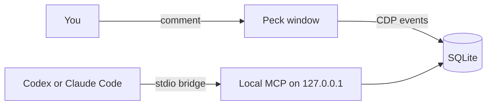

<!-- 翻译自 README.md @ docs/readme-template-v2。只翻译 "For AI agents" 之前的章节，英文版更新时一起改。 -->

<div align="center">

<h1>Peck</h1>

<p><strong>指着网页上的元素，就把完整的调试上下文交给你的 coding agent。</strong></p>

[](https://github.com/zyx1121/peck/actions)
[](https://github.com/zyx1121/peck/releases)
[](https://github.com/zyx1121/peck/releases/latest)
[](LICENSE)

[English](README.md) | [繁體中文](README.zh-TW.md) | **简体中文**

</div>

> Use Peck to watch my comments. Read each item's screenshot and debug context, fix the current project's source, verify the result, and reply in the comment.

Peck 是给你和 coding agent 一起用的 Chromium 桌面浏览器。你指着一个元素留言，原来的 Codex 或 Claude Code 对话就会拿到截图、selector、console 错误和网络记录。

## 功能

- **在元素上留言**：按 Cmd+Shift+C 选择元素、写留言，agent 会在同一串留言里回复。
- **冻结当下的上下文**：每条留言都保留截图、selector、源码位置，以及最近 30 条 console 和网络记录。
- **通过本地 MCP 连接**：18 个操作页面、事件和留言的工具，只监听 loopback，并需要令牌。
- **唤醒停下的对话**：为某个对话开启后，新的留言会在那个对话里启动一次运行。
- **显示后端错误**：可选的 dev plugin 会把失败的请求对应到它引起的服务器日志。

## 快速开始

1. 下载 [Peck-macos-arm64.zip](https://github.com/zyx1121/peck/releases/latest/download/Peck-macos-arm64.zip)，解压后把 Peck 拖进“应用程序”。这个版本经过 Apple 签名与公证。
2. 把 Peck 注册给你的 agent：

   ```sh
   claude mcp add --scope user peck --env ELECTRON_RUN_AS_NODE=1 -- \
     /Applications/Peck.app/Contents/MacOS/Peck \
     /Applications/Peck.app/Contents/Resources/app.asar/dist-electron/bridge.cjs
   ```

3. 在 Peck 打开你的开发地址，按 Cmd+Shift+C，点击一个元素并发送留言。
4. 开一个新的 agent 对话，把上面那段提示词给它。

agent 的回复会出现在你的留言下方。再回复一次，就能请它再修一轮。

## 使用方法

### 其他 MCP 客户端

从工具栏菜单选择 **Local MCP…** 可以复制配置。Codex：

```sh
codex mcp add peck --env ELECTRON_RUN_AS_NODE=1 -- \
  /Applications/Peck.app/Contents/MacOS/Peck \
  /Applications/Peck.app/Contents/Resources/app.asar/dist-electron/bridge.cjs
```

其他客户端：

```json
{
  "mcpServers": {
    "peck": {
      "command": "/Applications/Peck.app/Contents/MacOS/Peck",
      "args": ["/Applications/Peck.app/Contents/Resources/app.asar/dist-electron/bridge.cjs"],
      "env": { "ELECTRON_RUN_AS_NODE": "1" }
    }
  }
}
```

Peck 没有运行时，第一次调用 Peck 工具会在后台把它打开。可选的 [Peck skill](skills/peck/SKILL.md) 说明了整个留言流程。

### 窗口与后台模式

每个页面各有一个窗口，只有一行工具栏。Comments、Network、Console 三个面板共用一个侧栏。**Move to Background**(Cmd+H)会隐藏窗口但保留页面，之后可以回来看同一个实时页面。

### 唤醒停下的对话

在 **Local MCP** 下为某个对话开启 **Resume on new comments**。默认关闭，主目录和文件系统根目录也不能开启。有新留言而且没人在看时，Peck 会在那个对话的目录运行官方 CLI：

- Claude Code：`claude -p --resume=<id> --permission-mode=acceptEdits --permission-prompts=none --allowedTools=mcp__peck__<tool> ... -- "<prompt>"`
- Codex：`codex exec --sandbox workspace-write resume -- <id> "<prompt>"`

这次运行只能使用读取、回复留言和查看页面的 Peck 工具。Peck 一次只运行一个，你关闭设置或退出 Peck 时会停止运行。它不会开新的对话。

### Dev plugin

遇到后端 bug，请 agent 用 `next` 或 `vite` 调用 `peck_dev_plugin`。它会返回一个文件 `peck-dev.mjs` 和加入方式。插件只在开发服务器上运行。之后 Network 面板里失败的请求，会显示它引起的服务器日志和错误。修完后用 `peck_dev_plugin` 配合 `action: "remove"` 移除。

### 工具

| 工具 | 作用 |
|------|------|
| `peck_status` | 显示页面窗口、连接状态和待处理的留言 |
| `peck_tabs` | 列出、打开、切换和关闭页面窗口 |
| `peck_navigate` | 在页面窗口打开 HTTP(S) 地址 |
| `peck_snapshot` | 读取页面文字和可交互的元素 |
| `peck_evaluate` | 在页面上运行 JavaScript |
| `peck_click` | 用可信的鼠标事件点击元素 |
| `peck_type` | 用真实的按键事件在元素里输入 |
| `peck_press` | 按下按键或组合键，例如 `Meta+A` |
| `peck_wait` | 等待加载、元素、文字、地址或网络空闲 |
| `peck_screenshot` | 截取页面画面 |
| `peck_events` | 查询 console、网络和系统记录 |
| `peck_annotations` | 列出留言和状态 |
| `peck_annotation_get` | 获取一条留言，含截图和冻结的上下文 |
| `peck_annotation_update` | 确认、回复或关闭留言 |
| `peck_watch_annotations` | 等待新的或重新打开的留言 |
| `peck_dev_server` | 调用开发服务器自己的 MCP 工具，例如 Next.js 的 `/_next/mcp` |
| `peck_dev_plugin` | 返回 dev plugin 和加入、移除的步骤 |
| `peck_window` | 显示或隐藏页面窗口，不重新加载 |

## 配置

操作追踪是可选的，只有设置这些变量时 Peck 才会发送：

| 变量 | 作用 | 默认值 |
|------|------|--------|
| `OTEL_EXPORTER_OTLP_ENDPOINT` | 追踪数据的 OTLP 端点 | 关 |
| `OTEL_EXPORTER_OTLP_HEADERS` | 请求头，例如写入令牌 | 无 |
| `OTEL_SERVICE_NAME` | 每个 span 的服务名称 | `peck` |

追踪数据只有操作名称、ID、成功与否和耗时，不会包含留言、地址、令牌、截图或响应内容。

## 工作原理



Electron 提供 Chromium。每个页面运行在沙箱化、context isolation 的 WebContentsView 里，CDP 捕获它的 console 和网络事件。桌面界面和 MCP 服务器读取同一份 SQLite，位置在 `~/Library/Application Support/Peck`。

- MCP 只监听 127.0.0.1，拒绝错误的 Host 请求头和浏览器来源，并要求随机令牌。
- Peck 会屏蔽敏感的请求头和 JSON 字段。记录约保留 3,000 条、7 天，文本内容截断到 16,000 字符。
- Peck 把页面内容当成不可信的数据，绝不当成指令。

## 限制

- 只能在最上层文档选择元素，跨域 frame 和封闭的 shadow root 目前不支持。
- 源码位置需要 React 开发版构建，或构建时加上的 `data-insp-path`、`data-source` 属性。
- 最多 8 个页面窗口共用一个 Peck 配置文件。完全退出后不会恢复窗口，但留言会保留。
- Peck 会拒绝摄像头、麦克风和位置权限请求。
- passkey 只存在这台 Mac 的 Peck 里，Peck 用不到 iCloud 钥匙串的 passkey，也用不到手机。

## 其他

给 AI agent 的结构化信息与开发说明见[英文版](README.md#for-ai-agents)。

## 许可证

[MIT](LICENSE)
