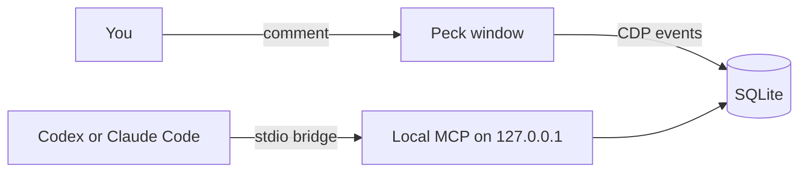

<!-- 翻譯自 README.md @ docs/readme-template-v2。只翻 "For AI agents" 以上的章節，英文版更新時一起改。 -->

<div align="center">

<h1>Peck</h1>

<p><strong>指著網頁上的元素，就把完整的除錯脈絡交給你的 coding agent。</strong></p>

[](https://github.com/zyx1121/peck/actions)
[](https://github.com/zyx1121/peck/releases)
[](https://github.com/zyx1121/peck/releases/latest)
[](LICENSE)

[English](README.md) | **繁體中文** | [简体中文](README.zh-CN.md)

</div>

> Use Peck to watch my comments. Read each item's screenshot and debug context, fix the current project's source, verify the result, and reply in the comment.

Peck 是給你和 coding agent 一起用的 Chromium 桌面瀏覽器。你指著一個元素留言，原本的 Codex 或 Claude Code 對話就會拿到截圖、selector、console 錯誤和網路紀錄。

## 功能

- **在元素上留言**：按 Cmd+Shift+C 選元素、寫留言，agent 會在同一串留言裡回覆。
- **凍結當下的脈絡**：每則留言都保留截圖、selector、原始碼位置，以及最近 30 筆 console 和網路紀錄。
- **透過本機 MCP 連線**：18 個操作頁面、事件和留言的工具，只聽 loopback，並需要權杖。
- **喚醒停下的對話**：替某個對話開啟後，新的留言會在那個對話裡啟動一次執行。
- **顯示後端錯誤**：選用的 dev plugin 會把失敗的請求對應到它造成的伺服器 log。

## 快速開始

1. 下載 [Peck-macos-arm64.zip](https://github.com/zyx1121/peck/releases/latest/download/Peck-macos-arm64.zip)，解壓縮後把 Peck 拖進「應用程式」。這個版本經過 Apple 簽章與公證。
2. 把 Peck 註冊給你的 agent：

   ```sh
   claude mcp add --scope user peck --env ELECTRON_RUN_AS_NODE=1 -- \
     /Applications/Peck.app/Contents/MacOS/Peck \
     /Applications/Peck.app/Contents/Resources/app.asar/dist-electron/bridge.cjs
   ```

3. 在 Peck 打開你的開發網址，按 Cmd+Shift+C，點一個元素並送出留言。
4. 開一個新的 agent 對話，把上面那段提示詞給它。

agent 的回覆會出現在你的留言底下。再回覆一次，就能請它再修一輪。

## 使用方式

### 其他 MCP 用戶端

從工具列選單選 **Local MCP…** 可以複製設定。Codex：

```sh
codex mcp add peck --env ELECTRON_RUN_AS_NODE=1 -- \
  /Applications/Peck.app/Contents/MacOS/Peck \
  /Applications/Peck.app/Contents/Resources/app.asar/dist-electron/bridge.cjs
```

其他用戶端：

```json
{
  "mcpServers": {
    "peck": {
      "command": "/Applications/Peck.app/Contents/MacOS/Peck",
      "args": ["/Applications/Peck.app/Contents/Resources/app.asar/dist-electron/bridge.cjs"],
      "env": { "ELECTRON_RUN_AS_NODE": "1" }
    }
  }
}
```

Peck 沒開時，第一次呼叫 Peck 工具會在背景把它打開。選用的 [Peck skill](skills/peck/SKILL.md) 說明了整個留言流程。

### 視窗與背景模式

每個頁面各有一個視窗，只有一列工具列。Comments、Network、Console 三個面板共用一個側欄。**Move to Background**(Cmd+H)會隱藏視窗但保留頁面，之後可以回來看同一個即時頁面。

### 喚醒停下的對話

在 **Local MCP** 底下替某個對話開啟 **Resume on new comments**。預設是關的，家目錄和檔案系統根目錄也不能開。有新留言而且沒人在看時，Peck 會在那個對話的目錄執行官方 CLI：

- Claude Code：`claude -p --resume=<id> --permission-mode=acceptEdits --permission-prompts=none --allowedTools=mcp__peck__<tool> ... -- "<prompt>"`
- Codex：`codex exec --sandbox workspace-write resume -- <id> "<prompt>"`

這次執行只能用讀取、回覆留言和查看頁面的 Peck 工具。Peck 一次只跑一個，你關掉設定或退出 Peck 時會停止執行。它不會開新的對話。

### Dev plugin

遇到後端的 bug，請 agent 用 `next` 或 `vite` 呼叫 `peck_dev_plugin`。它會回傳一個檔案 `peck-dev.mjs` 和加入方式。plugin 只在開發伺服器上執行。之後 Network 面板裡失敗的請求，會顯示它造成的伺服器 log 和錯誤。修完後用 `peck_dev_plugin` 搭配 `action: "remove"` 移除。

### 工具

| 工具 | 作用 |
|------|------|
| `peck_status` | 顯示頁面視窗、連線狀態和待處理的留言 |
| `peck_tabs` | 列出、開啟、切換和關閉頁面視窗 |
| `peck_navigate` | 在頁面視窗開啟 HTTP(S) 網址 |
| `peck_snapshot` | 讀取頁面文字和可互動的元素 |
| `peck_evaluate` | 在頁面上執行 JavaScript |
| `peck_click` | 用可信的滑鼠事件點擊元素 |
| `peck_type` | 用真實的按鍵事件在元素裡輸入 |
| `peck_press` | 按下按鍵或組合鍵，例如 `Meta+A` |
| `peck_wait` | 等待載入、元素、文字、網址或網路閒置 |
| `peck_screenshot` | 擷取頁面畫面 |
| `peck_events` | 查詢 console、網路和系統紀錄 |
| `peck_annotations` | 列出留言和狀態 |
| `peck_annotation_get` | 取得一則留言，含截圖和凍結的脈絡 |
| `peck_annotation_update` | 確認、回覆或結案留言 |
| `peck_watch_annotations` | 等待新的或重新開啟的留言 |
| `peck_dev_server` | 呼叫開發伺服器自己的 MCP 工具，例如 Next.js 的 `/_next/mcp` |
| `peck_dev_plugin` | 回傳 dev plugin 和加入、移除的步驟 |
| `peck_window` | 顯示或隱藏頁面視窗，不重新載入 |

## 設定

操作追蹤是選用的，只有設定這些變數時 Peck 才會送出：

| 變數 | 作用 | 預設 |
|------|------|------|
| `OTEL_EXPORTER_OTLP_ENDPOINT` | 追蹤資料的 OTLP 端點 | 關 |
| `OTEL_EXPORTER_OTLP_HEADERS` | 標頭，例如寫入權杖 | 無 |
| `OTEL_SERVICE_NAME` | 每個 span 的服務名稱 | `peck` |

追蹤資料只有操作名稱、ID、成功與否和耗時，不會包含留言、網址、權杖、截圖或回應內容。

## 運作方式



Electron 提供 Chromium。每個頁面跑在沙箱化、context isolation 的 WebContentsView 裡，CDP 擷取它的 console 和網路事件。桌面介面和 MCP 伺服器讀同一份 SQLite，位置在 `~/Library/Application Support/Peck`。

- MCP 只聽 127.0.0.1，拒絕錯誤的 Host 標頭和瀏覽器來源，並要求隨機權杖。
- Peck 會遮掉敏感的標頭和 JSON 欄位。紀錄約保留 3,000 筆、7 天，文字內容截到 16,000 字元。
- Peck 把頁面內容當成不可信的資料，絕不當成指令。

## 限制

- 只能在最上層文件選元素，跨來源的 frame 和封閉的 shadow root 目前不支援。
- 原始碼位置需要 React 開發版建置，或建置時加上的 `data-insp-path`、`data-source` 屬性。
- 最多 8 個頁面視窗共用一個 Peck 設定檔。完全退出後不會還原視窗，但留言會保留。
- Peck 會拒絕相機、麥克風和位置權限請求。
- passkey 只存在這台 Mac 的 Peck 裡，Peck 用不到 iCloud 鑰匙圈的 passkey，也用不到手機。

## 其他

給 AI agent 的結構化資訊與開發說明在[英文版](README.md#for-ai-agents)。

## 授權

[MIT](LICENSE)
